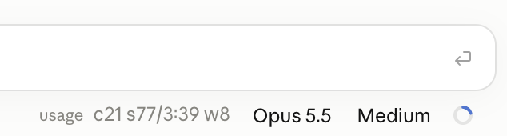

# claude-mods / Usage

[English](README.md)

Claude Desktopにおいて、Claude Codeの入力欄の下に、利用状況をコンパクトに1行表示するmodです。



```
usage c21 s77/3:39 w8
```

| 表示 | 意味 |
| --- | --- |
| `c21` | コンテキストウィンドウの使用率（%） |
| `s77/3:39` | 現在のセッション（5時間枠）の使用率（%）と、リセットまでの残り時間（時:分） |
| `w8` | 週間（7日枠）の使用率（%） |

Claude Desktop（Codeタブ）専用です。ターミナル（CLI）の表示は変更しません。同じセッションをClaude Desktopとターミナルの両方で開いている間は、どちらにも表示しません。

値が届いていない項目は表示しません。表示はターンが終わるたびに更新され、リセットまでの残り時間は1分ごとに更新されます。

## インストール

Claude Code 2.1.287以降が必要です（modに対応した最初のバージョン。動作確認は2.1.295）。

1. Claude DesktopのCodeタブで、入力欄の下の「+」 → 「プラグインを追加」を開きます。
2. 右上の「+ 追加」 → 「マーケットプレイスを追加」 → 「リポジトリから追加」を選び、`kkatsuyoshi/claude-mods`と入力して「同期」をクリックします。
3. 「Usage」から「追加」をクリックします（「Usage」が見つからない場合は「プラグインを追加」の画面から、下にスクロールして「このコンピュータ」 → 「kkatsuyoshi」をたどってください）。

## アンインストール

1. Claude DesktopのCodeタブで、入力欄の下の「+」 → 「プラグインを追加」を開きます。
2. 下にスクロールして「このコンピュータ」 → 「kkatsuyoshi」をクリックします。
3. 「Usage」の右側、「…」のメニューより「削除」をクリックします。
